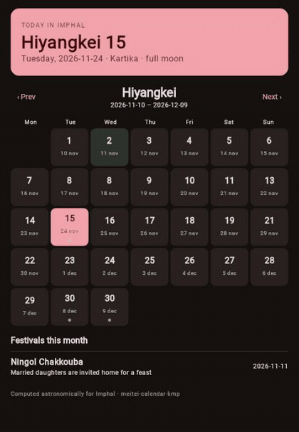

# meitei-calendar-kmp

[](https://github.com/Frantica/meitei-calendar-kmp/actions/workflows/ci.yml)


A **Kotlin Multiplatform** library for the **Meitei (Manipuri) lunar calendar**: Sajibu to Lamta, leap months, lunar days (tithi) and festival dates such as Cheiraoba, Kang, Kwak Jatra, Ningol Chakkouba and Yaoshang.

Dates are **computed astronomically** (new moons, the Sun's sidereal sign and sunrise in Imphal), so there are no tables to update each year.

A standalone project by the developer of **Kumsing**, a Manipuri calendar app on [Google Play](https://play.google.com/store/apps/details?id=com.kanglalabs.kumsing) and the [App Store](https://apps.apple.com/in/app/kumsing-manipuri-calendar-2026/id6804580494). The code here is separate from that app.

**[▶ Try the web demo](https://frantica.github.io/meitei-calendar-kmp/)**

<p align="center"></p>

## Install

Not published to a Maven repository yet. To try it locally:

```bash
./gradlew :meitei-calendar:publishToMavenLocal
```

Then add `mavenLocal()` to your repositories and depend on `io.github.frantica:meitei-calendar:0.1.0`.

## Usage

```kotlin
val calendar = MeiteiCalendar.Default            // reckoned for Imphal

calendar.fromGregorian(LocalDate(2025, 3, 30))   // Sajibu 1
calendar.fromGregorian(LocalDate(2023, 7, 30))   // a day in leap Thawan

calendar.dateOf(Festivals.CHEIRAOBA, 2026)       // Meitei New Year
calendar.festivals(2026)                         // all festivals, sorted
calendar.monthsOverlapping(2026)                 // 13 months in a leap year
```

| API | Returns |
|---|---|
| `fromGregorian(date)` | `MeiteiDate(month, tithi, isLeapMonth, paksha)` |
| `monthContaining(date)`, `next(span)`, `previous(span)` | `MeiteiMonthSpan(month, startDate, endDate, isLeapMonth)` |
| `monthsOverlapping(year)` | Every lunar month overlapping a Gregorian year |
| `festivals(year)`, `dateOf(festival, year)` | Festival dates |

## How it works

| Rule | Implementation |
|---|---|
| A month runs from new moon to new moon (*amanta*) | New-moon instants from Meeus, *Astronomical Algorithms*, ch. 49 (tested to within 3 minutes of published times) |
| A month starts on the first day whose sunrise is after the new moon | Sunrise for Imphal (24.82° N, 93.94° E, IST) |
| Month names follow the Sun's sidereal sign at the new moon: Sun in Meena starts **Sajibu** | Solar longitude (Meeus ch. 25), Lahiri ayanamsa |
| No change of sign during a month means a **leap month** | `isLeapMonth = true`, named after the following month |
| The day number is the **tithi** at sunrise | Moon–Sun elongation ÷ 12° (Meeus ch. 47) |

All logic lives in `commonMain`, with no platform code. The tests check it against published new-moon times and known festival and leap-month dates.

## Project structure

```
meitei-calendar/   KMP library: Android, iOS, JVM, Wasm
composeApp/        Compose Multiplatform demo: Android, Desktop, Web (iOS entry point only, no Xcode project yet)
```

Run the demo:

```bash
./gradlew :composeApp:run                         # desktop
./gradlew :composeApp:wasmJsBrowserDevelopmentRun # web
./gradlew :composeApp:installDebug                # Android device
./gradlew :meitei-calendar:jvmTest                # tests
```

## Limitations
- Festivals that are set locally each year (for example Lai Haraoba) are not included.
- The rare *kshaya* (lost) month is not modelled.
- A tithi that ends within a few minutes of sunrise can differ from printed almanacs, which use their own calculation methods.

## License
MIT © Abhijeet Mutum
